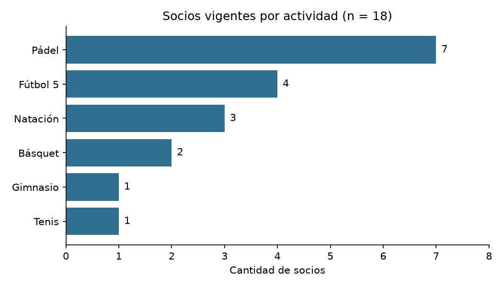
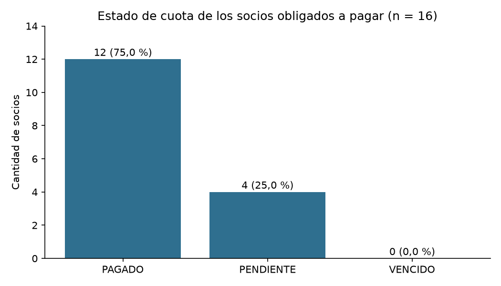

# TP N° 3 – Análisis y visualización

**Introducción al Análisis de Datos – UTN FRT – TUP (Plan 2024)** · Caso: Club Deportivo Cerro Alto

## Herramienta y datos

Python con pandas y matplotlib; las consultas SQL se ejecutan sobre SQLite (en memoria) con el archivo `consultas.sql`. Se parte del dataset limpio del TP 2 (`datos/Registro_Socios_LIMPIO.xlsx`, 19 socios).

**Definiciones usadas**

- *Socio vigente*: categoría distinta de Inactivo (no fue dado de baja). Incluye Activo, Cadete, Vitalicio y Honorario.
- *Socio obligado*: vigente y con estado distinto de EXENTO (debe pagar cuota).
- *Cuota al día*: estado PAGADO.

**Advertencia:** con solo 19 socios, los porcentajes dan saltos grandes (un socio equivale a más de 5 puntos). Las conclusiones son descriptivas del padrón, no tendencias estadísticas.

## Pregunta 1 – ¿Cuántos socios vigentes hay y cómo se reparten por actividad?

**Método:** consulta SQL (conteo agrupado por actividad).

```sql
SELECT
    actividad,
    COUNT(*) AS socios_vigentes
FROM socios
WHERE (categoria <> 'Inactivo' OR categoria IS NULL)
  AND actividad IS NOT NULL
GROUP BY actividad
ORDER BY socios_vigentes DESC, actividad;
```

| actividad | socios_vigentes |
|---|---|
| Pádel | 7 |
| Fútbol 5 | 4 |
| Natación | 3 |
| Básquet | 2 |
| Gimnasio | 1 |
| Tenis | 1 |



**Elección del gráfico:** es una comparación de cantidades entre categorías nominales (actividades), por eso se usan barras horizontales ordenadas de mayor a menor, con el valor escrito en cada barra y el eje desde cero. Las barras horizontales dejan leer los nombres sin rotarlos y el orden permite ver el ranking de un vistazo. Una torta se descarta: con 6 categorías y valores chicos, comparar ángulos es más difícil que comparar largos. (Contrastá este argumento con tus apuntes de la Unidad 5.)

**Interpretación:** Pádel concentra 7 de los 18 socios vigentes (38,9 %), y Gimnasio y Tenis tienen un solo socio cada una. La comisión puede usar esto para decidir dónde reforzar la capacidad (horarios y canchas de Pádel) y qué actividades de baja participación conviene promover o evaluar si se justifica mantenerlas. Con tan pocos socios, una sola alta o baja cambia el ranking.

## Pregunta 2 – ¿Qué porcentaje de los socios obligados a pagar tiene la cuota al día?

**Método:** pandas (filtro de socios obligados y conteo por estado); verificado con SQL.

```python
obligados = df[(df['categoria'] != 'Inactivo') & (df['estado'] != 'EXENTO')]
conteo = obligados['estado'].value_counts()
```

```sql
SELECT
    estado,
    COUNT(*) AS socios,
    COALESCE(SUM(cuota), 0) AS monto
FROM socios
WHERE (categoria <> 'Inactivo' OR categoria IS NULL)
  AND estado IS NOT NULL
  AND estado <> 'EXENTO'
GROUP BY estado
ORDER BY estado;
```

| estado | socios | porcentaje | monto |
|---|---|---|---|
| PAGADO | 12 | 75,0 % | $ 212.500 |
| PENDIENTE | 4 | 25,0 % | $ 74.000 |
| VENCIDO | 0 | 0,0 % | $ 0 |

Socios con cuota sin pagar:

| id_socio | socio | actividad | estado | cuota | contacto |
|---|---|---|---|---|---|
| 102 | Rocio Farias | Pádel | PENDIENTE | $ 18.500 | solo teléfono |
| 106 | Lucia Peralta | Fútbol 5 | PENDIENTE | $ 18.500 | email y teléfono |
| 112 | Carlos Rodríguez | Fútbol 5 | PENDIENTE | $ 18.500 | email y teléfono |
| 115 | Elena Díaz | Natación | PENDIENTE | $ 18.500 | solo email |



**Elección del gráfico:** se compara la cantidad de socios en cada estado de pago, que es una variable categórica con pocas categorías. Barras verticales con la cantidad y el porcentaje sobre cada una, eje desde cero y los tres estados posibles (aunque VENCIDO sea 0, para que se vea que no hay). Se evita la torta porque con un estado en cero y dos con valores muy distintos aporta menos que las barras.

**Interpretación:** 12 de 16 socios obligados tienen la cuota al día (75,0 %); 4 figuran PENDIENTE y 0 VENCIDO, lo que equivale a $ 74.000 sin cobrar (25,8 % de $ 286.500 facturados a socios obligados). La comisión puede contactar a esos socios: Rocio Farias (Pádel, solo teléfono); Lucia Peralta (Fútbol 5, email y teléfono); Carlos Rodríguez (Fútbol 5, email y teléfono); Elena Díaz (Natación, solo email). Si se incluyera al socio dado de baja con cuota vencida, el porcentaje al día bajaría a 70,6 %: por eso se lo excluye, ya que su deuda no es morosidad de un socio activo. PENDIENTE no necesariamente significa mora: conviene confirmar con la administración si esas cuotas ya vencieron. Los montos incluyen 1 cuota corregida en el TP 2 (supuesto a confirmar).

## Pregunta 3 – ¿Cuál es la cuota promedio por categoría de socio?

**Método:** consulta SQL (promedio agrupado por categoría); verificada con pandas.

```sql
SELECT
    categoria,
    COUNT(*) AS socios,
    ROUND(AVG(cuota), 0) AS cuota_promedio,
    MIN(cuota) AS cuota_minima,
    MAX(cuota) AS cuota_maxima
FROM socios
WHERE categoria IS NOT NULL
GROUP BY categoria
ORDER BY categoria;
```

| categoria | socios | cuota_promedio | cuota_minima | cuota_maxima |
|---|---|---|---|---|
| Activo | 14 | $ 18.750 | $ 18.500 | $ 22.000 |
| Cadete | 2 | $ 12.000 | $ 12.000 | $ 12.000 |
| Honorario | 1 | $ 0 | $ 0 | $ 0 |
| Inactivo | 1 | $ 18.500 | $ 18.500 | $ 18.500 |
| Vitalicio | 1 | $ 0 | $ 0 | $ 0 |

**Interpretación:** La cuota estándar es $ 18.500. El promedio de la categoría Activo ($ 18.750) queda por encima porque incluye un socio con otra cuota (Lucas Ferreyra de Tenis: $ 22.000). Los socios Vitalicio y Honorario tienen cuota $ 0 por estatuto, así que no aportan ingreso mensual. La comisión puede revisar si las diferencias de cuota entre actividades responden a una política definida y cuántos socios exentos hay. Atención: el valor de la categoría Cadete incluye 1 cuota corregida en el TP 2 (supuesto a confirmar con el club).

## Pregunta 4 – ¿Cómo evolucionaron las altas de socios por año?

**Método:** pandas (conteo por año de alta); verificado con SQL.

```python
con_fecha = df.dropna(subset=['anio_alta'])
altas = con_fecha.groupby('anio_alta').size()
```

| anio | altas |
|---|---|
| 2021 | 1 |
| 2022 | 1 |
| 2023 | 2 |
| 2024 | 13 |
| sin fecha válida | 2 |

**Interpretación:** 13 de las 17 altas con fecha válida son de 2024, y la última alta registrada es del 05/08/2024: no hay altas con fecha válida posteriores. Hay 2 socios sin fecha de alta válida (106, 119) que podrían ser altas recientes. La comisión puede preguntarse si el club dejó de sumar socios o si el padrón no se actualizó, y regularizar esas fechas antes de sacar conclusiones sobre el crecimiento.

## Verificaciones realizadas

Cada resultado se calculó por dos caminos (SQL y pandas) y se compararon: 8 de 8 verificaciones coinciden.

- OK: P1: el conteo por actividad de SQL coincide con pandas
- OK: P1: la suma por actividad es igual al total de socios vigentes
- OK: P2: conteo de estados de pandas coincide con SQL
- OK: P2: montos por estado de pandas coinciden con SQL
- OK: P3: los promedios por categoría de SQL coinciden con pandas
- OK: P3: la suma de socios por categoría es igual al total de socios
- OK: P4: las altas por año de pandas coinciden con SQL
- OK: P4: altas con fecha + socios sin fecha válida = total de socios

## Uso de inteligencia artificial

El registro del proceso (problema → propuesta → análisis → verificación → corrección) está en `registro_uso_ia_tp3.md`.
